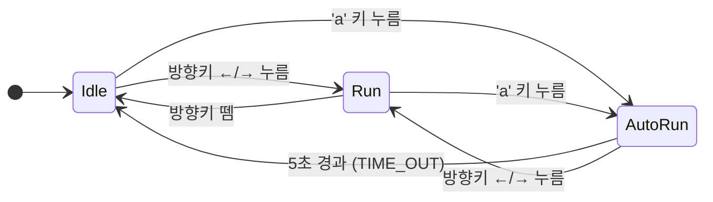
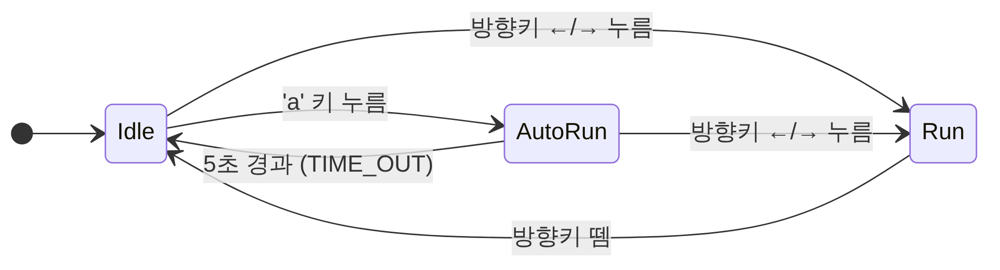

# Drill #11 상태 다이어그램

소년(Boy)의 상태 머신. 상태 3개(Idle / Run / AutoRun)와 전이 트리거.

## 전이 테이블 (autorun.py 의 set_transitions 와 1:1 대응)

| 현재 상태 | 이벤트 | 다음 상태 |
|---|---|---|
| Idle | right_down / left_down / right_up / left_up | Run |
| Idle | a_down | AutoRun |
| Run | right_down / left_down / right_up / left_up | Idle |
| Run | a_down | AutoRun |
| AutoRun | time_out (5초 경과) | Idle |
| AutoRun | right_down / left_down | Run |

## 상태별 동작

| 상태 | 애니메이션 행(bottom) | 속도 | 크기 | 비고 |
|---|---|---|---|---|
| Idle | 300(우) / 200(좌) | 0 | 100x100 | 제자리 대기 |
| Run | 100(우) / 0(좌) | RUN_SPEED_PPS | 100x100 | 화면 끝에서 clamp |
| AutoRun | 100(우) / 0(좌) | RUN_SPEED_PPS × 2 | 150x150 | 화면 끝에서 자동 방향 전환 |
